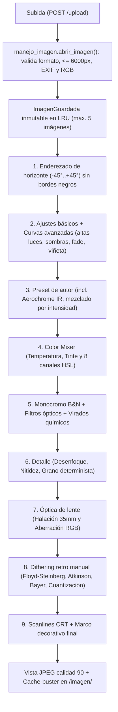

# Ditherix

> **Laboratorio fotográfico web, cuarto oscuro digital y motor de tramado retro en tiempo real.**  
> Procesamiento de imagen no destructivo en memoria con **Python**, **Flask**, **Pillow** y **NumPy**, compuesto por una portada editorial animada con WebGL y un estudio de edición de geometría ortogonal (`border-radius: 0`).

---

## Contenidos

1. [Visión General](#visión-general)
2. [Funcionalidades del Sistema](#funcionalidades-del-sistema)
   - [Portal de Inicio (Landing)](#portal-de-inicio-landing)
   - [Editor y Pipeline No Destructivo](#editor-y-pipeline-no-destructivo)
   - [Luz, Curvas Avanzadas e Histograma](#luz-curvas-avanzadas-e-histograma)
   - [Óptica 35mm y Simulación CRT](#óptica-35mm-y-simulación-crt)
   - [Motor de Dithering Retro & Duotono](#motor-de-dithering-retro--duotono)
   - [Mezclador HSL y Balance de Blancos](#mezclador-hsl-y-balance-de-blancos)
   - [Laboratorio B&N y Virados Químicos](#laboratorio-bn-y-virados-químicos)
   - [Detalle y Grano Analógico](#detalle-y-grano-analógico)
   - [Marcos Procedimentales](#marcos-procedimentales)
   - [Geometría, Comparador Split y Visor](#geometría-comparador-split-y-visor)
3. [Catálogo de Presets (12 Estilos)](#catálogo-de-presets-12-estilos)
4. [Arquitectura del Pipeline](#arquitectura-del-pipeline)
5. [Estructura del Proyecto](#estructura-del-proyecto)
6. [Instalación y Puesta en Marcha](#instalación-y-puesta-en-marcha)
7. [Despliegue](#despliegue)
8. [Referencia de Rutas y API](#referencia-de-rutas-y-api)
9. [Atajos de Teclado y Controles](#atajos-de-teclado-y-controles)
10. [Autor](#autor)

---

## Visión General

**Ditherix** combina fotografía analógica, emulsiones experimentales, óptica 35mm y tramado pixel-art/retro en una aplicación web sin base de datos ni procesamiento destructivo permanente en cliente. Cada foto subida permanece almacenada en memoria del servidor dentro de una estructura inmutable (`ImagenGuardada`), y cada cambio recalcula únicamente las etapas necesarias dentro de un pipeline ordenado de 9 pasos.

La aplicación se divide en dos experiencias conectadas:
- **Portada (`/`)**: diseño editorial blanco y negro con fondo líquido WebGL interactivo, preloader `000% -> 100%`, galería horizontal de 8 paneles, comparador interactivo, reloj HUD, visualizador de onda sonora y audio táctil procedural en Web Audio.
- **Editor (`/editor` o `/app`)**: apertura vertical con cortina negra, barras flotantes translúcidas en cristal ahumado con esquinas de 90°, sliders reactivos en tiempo real con cola de cancelación y visor con zoom centrado en cursor.

---

## Funcionalidades del Sistema

### Portal de Inicio (Landing)
- **Fondo líquido WebGL** (`static/landing.js`): shader animado en tiempo real sobre lienzo fijo blanco.
- **Preloader teatral** (`cinemaLoader`): contador progresivo `000%`–`100%` (con opción de omitir por clic o `Esc`) seguido de apertura vertical de cortinas.
- **Scroll horizontal suavizado** en 8 paneles (`PORTADA`, `DITHERING`, `COMPARADOR`, `QUÍMICA`, `MARCOS`, `PRESETS`, `ESTUDIO`, `AUTOR`), comparador interactivo Antes/Después, reloj HUD y audio táctil siempre activo sin dependencias externas.

### Editor y Pipeline No Destructivo
- **Cortina de entrada**: al acceder a `/editor`, una pantalla negra partida verticalmente (`#editorCurtain`) se abre suavemente igual que en la landing sin pantalla de carga numérica.
- **Formatos y límites**: soporta `JPEG`, `PNG` y `WEBP` hasta **25 MB** y **6000×6000 px** por lado (`manejo_imagen.py`), aplicando corrección automática de orientación EXIF y conversión limpia sobre fondo blanco si la imagen tiene canal alfa.
- **Gestión LRU en memoria**: mantiene hasta **5 sesiones simultáneas** (`MAX_IMAGENES_EN_MEMORIA = 5`) protegidas con bloqueo de concurrencia (`imagenes_lock`) y control de carrera por versión de solicitud.

### Luz, Curvas Avanzadas e Histograma
- **Ajustes básicos** (`ajustes_imagen.py`): Brillo, Contraste y Saturación (`-100` a `+100`).
- **Tono avanzado vectorizado en `float32`**:
  - **Altas luces** y **Sombras** basadas en luminancia perceptual Rec. 709.
  - **Desvanecer (Fade)** (`0` a `100`): elevación exponencial suave del punto negro estilo película mate.
  - **Viñeta óptica** (`-100` a `+100`): máscara radial elíptica para oscurecer o aclarar esquinas.
- **Histograma en vivo** (`script.js`): analizador en cliente dibujado en `<canvas>` con modo conmutable entre **LUMA** y canales superpuestos **RGB** haciendo clic sobre el gráfico.

### Óptica 35mm y Simulación CRT
- **Halación 35mm** (`optica.py`): aísla brillos especulares altos (`lum > 0.70`), genera halo rojo-ámbar desenfocado tipo película sin capa anti-halación (Cinestill) y mezcla en modo *Screen*.
- **Aberración cromática radial**: reescala progresivamente los canales R y G mediante transformación afín desde el centro óptico hacia los bordes.
- **Scanlines CRT**: líneas de barrido horizontales adaptadas automáticamente a la resolución de la imagen y aplicadas después del dithering para preservar nitidez.

### Motor de Dithering Retro & Duotono
- **Algoritmos** (`dithering.py`):
  - `floyd_steinberg` (difusión de error clásica).
  - `atkinson` (difusión Macintosh 1984 con 75% de dispersión hacia 6 vecinos).
  - `bayer_4` y `bayer_8` (tramado ordenado por matriz acelerado con NumPy).
  - `cuantizacion` (reducción directa de paleta sin trama).
- **Paletas integradas**: `bn` (1-bit), `gameboy`, `cga`, `ambar`, `cyberpunk`, `matrix`, `vaporwave`, `termica` y **`duotono` personalizado** (colores hex oscuro/claro seleccionables + 4 swatches rápidos).
- **Pre-umbral** (`-100` a `+100`), **Tamaño de píxel** (`1` a `8` con reescalado `NEAREST`), **Intensidad** (`0%` a `100%`) y **Render Pixel-Perfect** (`image-rendering: pixelated`), activado automáticamente al usar dithering o presets tramados.

### Mezclador HSL y Balance de Blancos
- **Temperatura Kelvin** (`-100` frío/azul a `+100` cálido/ámbar) y **Tinte** (`-100` verde a `+100` magenta) mediante ganancias equilibradas (`color_mixer.py`).
- **Mezclador de 8 canales** (`rojo`, `naranja`, `amarillo`, `verde`, `cyan`, `azul`, `violeta`, `rosa`) con control independiente de **Tono**, **Saturación** y **Luminancia** usando interpolación cúbica continua de Hermite y compuerta de saturación (`sat_gate`) para no contaminar grises ni blancos.

### Laboratorio B&N y Virados Químicos
- Conversión monocroma Rec. 709 con **8 canales continuos** y **7 filtros ópticos preestablecidos** (`neutro`, `rojo`, `naranja`, `amarillo`, `verde`, `azul`, `infrarrojo` en `byn.py`).
- **Virados químicos Split-Tone** con control de intensidad (`0%`–`100%`): `ninguno`, `sepia`, `cianotipia`, `selenio` y `platino`.

### Detalle y Grano Analógico
- **Desenfoque / Enfoque** (`GaussianBlur` y `UnsharpMask`), **Nitidez** (`ImageEnhance.Sharpness`) y **Grano analógico** determinista en caché por resolución (semilla fija para evitar parpadeo mientras se mueven otros controles en `detalle.py`).

### Marcos Procedimentales
- Aplicados siempre al final del pipeline (`marcos.py`) para que no se deformen por otros filtros:
  - `liso` (color hexadecimal configurable y grosor proporcional en px).
  - `polaroid` (cartón blanco roto con proporciones clásicas `6.5%` / `23%` y bisel fino).
  - `polaroid_gastado` (cartón envejecido con ruido orgánico y bordes quemados).
  - `pelicula` (tira negativa 35mm `#0c0c0e` con perforaciones iluminadas y tipografía retro `KODAK 400` / `SAFETY FILM`).

### Geometría, Comparador Split y Visor
- **Recorte no destructivo** (`recortar.py`, `app.py`): proporciones `Libre`, `1:1`, `4:5`, `16:9`, `3:2`, `4:3`, rejilla de tercios y botón **Restablecer** que devuelve exactamente el estado previo al recorte sin borrar ajustes anteriores (`pre_recorte_*`).
- **Enderezado de horizonte** (`geometria.py`): rotación `-45°` a `+45°` en bicúbico con recorte automático al rectángulo útil inscrito (sin esquinas negras).
- **Rotación 90°** horaria y **Volteo horizontal / vertical** (`voltear_imagen.py`).
- **Comparador Split Antes / Después** (`script.js`): cortina deslizable vertical entre `/original/<id>` y la imagen procesada, manipulable por puntero, teclado o botones rápidos (`Original` / `Editada`).
- **Visor HUD** (`visor.js`): paneo fluido, zoom hacia el cursor (`20%` a `800%`) e indicador flotante `- / 100% / +`.
- **Exportación directa**: botón superior de descarga de la imagen procesada (`ditherix-export.jpg`).

---

## Catálogo de Presets (12 Estilos)

Todos los presets soportan ajuste de intensidad (`0%` a `100%`) en `presets.py`:

| Nº | ID | Nombre | Categoría | Técnicas principales |
|---|---|---|---|---|
| `01` | `cinestill_neon_800` | **Cinestill 800T** | CINE 35MM | Halación 35mm (78), aberración (16), balance tungsteno (-18), grano (32), marco `pelicula` |
| `02` | `midnight_touge` | **Midnight Touge** | MOTOR CRT | Contraste (+34), viñeta (-40), fade (14), halación (42), aberración (36), scanlines CRT (22) |
| `03` | `riso_crimson_press` | **Risograph Press** | DUOTONO | Dither `bayer_8` duotono `#141c52` / `#ff6352`, pre-umbral (+10), píxel 1× |
| `04` | `mac_atkinson_1bit` | **Macintosh 1984** | 1-BIT | Difusión `atkinson` 1-bit `#0b0c10` / `#eceae1`, sombras (+14), píxel 2× |
| `05` | `infrared_aerochrome` | **Kodak Aerochrome** | INFRARROJO | Virado falso infrarrojo (`_aplicar_aerochrome_rgb`), halación (34), viñeta (-32), grano (24) |
| `06` | `vhs_camcorder_94` | **VHS Camcorder 94** | ANALOG CRT | Aberración RGB (58), scanlines (52), fade (28), viñeta (-44), desenfoque (8), grano (42) |
| `07` | `kodachrome_archive` | **Kodachrome 64** | ARCHIVO | Contraste (+24), calidez (+12), fade (10), viñeta (-22), marco liso `#f5f3ec` |
| `08` | `monochrome_platinum` | **Platino Paladio** | GALERÍA B&N | Monocromo con filtro óptico `naranja` y virado químico `platino` (80%) |
| `09` | `cyber_thermal_hud` | **Thermal Predator** | TÉRMICO | Dither `bayer_4` paleta `termica`, píxel 2×, scanlines (30), aberración (24) |
| `10` | `bleach_bypass_noir` | **Silver Bleach** | CINE NOIR | Contraste (+42), saturación (-56), viñeta (-52), nitidez (+50), halación (18), grano (36) |
| `11` | `amber_terminal_crt` | **Ámbar Mainframe** | TERMINAL | `floyd_steinberg` paleta `ambar`, píxel 2×, scanlines CRT (46), halación (30), viñeta (-48) |
| `12` | `instant_sx70_dream` | **Instant SX-70** | POLAROID | Fade (32), halación (54), brillo (+6), contraste (-6), desenfoque (4), marco `polaroid` |

---

## Arquitectura del Pipeline



---

## Estructura del Proyecto

```text
Ditherix/
├── app.py                  # Servidor Flask, dataclass ImagenGuardada, rutas REST y pipeline
├── api/
│   └── index.py            # Entrypoint WSGI para despliegue serverless en Vercel
├── ajustes_imagen.py       # Brillo, contraste, saturación y curvas float32 (luz, fade, viñeta)
├── byn.py                  # Conversión Rec. 709, filtros ópticos y virados químicos
├── color_mixer.py          # Balance de blancos y mezclador HSL continuo de 8 canales
├── detalle.py              # Desenfoque/enfoque, nitidez y trama de grano en caché
├── dithering.py            # Floyd-Steinberg, Atkinson, Bayer 4x4/8x8, paletas y duotono
├── geometria.py            # Rotación 90° y enderezado con recorte rectangular inscrito
├── manejo_imagen.py        # Validación de archivos, límites de seguridad, EXIF y exportación JPEG/PNG
├── marcos.py               # Marcos procedurales: liso, Polaroid, Polaroid gastado y 35mm
├── optica.py               # Halación 35mm, aberración cromática radial y scanlines CRT
├── presets.py              # DefinicionPreset, Aerochrome IR y catálogo de 12 presets
├── recortar.py             # Envoltorio Pillow para recorte por coordenadas enteras
├── voltear_imagen.py       # Espejo horizontal y vertical
├── frame.py                # Reservado (vacío; los marcos residen en marcos.py)
├── requirements.txt        # Dependencias Python (+ marcador de entorno para Gunicorn)
├── Procfile                # Arranque Gunicorn para entornos PaaS Linux
├── render.yaml             # Manifiesto de despliegue en Render (Python 3.12.8)
├── vercel.json             # Enrutamiento hacia /api/index
├── COMANDOS.txt            # Guía rápida local para PowerShell en Windows
├── templates/
│   ├── landing.html        # Portada WebGL interactiva con preloader y 8 paneles
│   └── index.html          # Interfaz principal del editor fotográfico
└── static/
    ├── landing.css         # Estilos suizos blanco/negro y cortina teatral de la portada
    ├── landing.js          # WebGL líquido, scroll horizontal, audio procedural y comparador
    ├── style.css           # Estilos Hallmark Darkroom del editor (cristal ahumado a 90°)
    ├── script.js           # Estado del editor, tiempo real, histograma, recorte, comparador y cortina
    ├── visor.js            # Zoom centrado en puntero, paneo y gestión exclusiva de paneles
    ├── fonts/              # Tipografías locales
    ├── icon/               # Favicon del sitio
    └── images/             # Recursos visuales mostrados en la portada
```

---

## Instalación y Puesta en Marcha

### Prerrequisitos
- **Python 3.10 o superior** (en producción se recomienda 3.12+; probado localmente en Python 3.14).
- **pip**.

### Pasos locales

1. Clonar el repositorio:
   ```bash
   git clone https://github.com/Limeres1/Ditherix.git
   cd Ditherix
   ```

2. Crear y activar el entorno virtual:
   ```powershell
   # Windows PowerShell
   python -m venv .venv
   .\.venv\Scripts\Activate.ps1
   ```
   ```bash
   # macOS / Linux
   python3 -m venv .venv
   source .venv/bin/activate
   ```

3. Instalar dependencias:
   ```bash
   pip install -r requirements.txt
   ```

4. Iniciar el servidor de desarrollo:
   ```bash
   python app.py
   ```

5. Abrir en el navegador:
   - **Portada**: `http://127.0.0.1:5000/`
   - **Editor**: `http://127.0.0.1:5000/editor` (también disponible en `/app`)

---

## Despliegue

- **Render (`render.yaml` / `Procfile`)**: instala `requirements.txt` (incluyendo `gunicorn` en Linux) y ejecuta `gunicorn --workers 1 --threads 4 --timeout 120 app:app`. Mantener `--workers 1` asegura que las sesiones en memoria (`imagenes_guardadas`) compartan el mismo proceso.
- **Vercel (`vercel.json` + `api/index.py`)**: enruta todo el tráfico hacia la aplicación Flask WSGI expuesta desde `api/index.py`.

---

## Referencia de Rutas y API

| Método | Ruta | Cuerpo / Entrada | Descripción |
|---|---|---|---|
| `GET` | `/` | — | Renderiza la portada interactiva (`landing.html`). |
| `GET` | `/editor`, `/app` | — | Renderiza el editor (`index.html`). |
| `POST` | `/upload` | `FormData(imagen=File)` | Carga una imagen (máx. 25 MB), valida y crea un `imagen_id`. |
| `GET` | `/imagen/<imagen_id>` | Query `?v=<token>` opcional | Devuelve la vista procesada actual en JPEG (`no-store`). |
| `GET` | `/original/<imagen_id>` | Query `?t=<ts>` opcional | Devuelve la vista base sin efectos para el comparador Split. |
| `GET` | `/presets` | — | Devuelve JSON con metadatos de los 12 presets base. |
| `POST` | `/imagen/<imagen_id>/ajustes` | `{ brillo, contraste, saturacion, altas_luces, sombras, fade, vineta, ... }` | Aplica ajustes tonales y curvas avanzadas (`-100..100`, `fade` `0..100`). |
| `POST` | `/imagen/<imagen_id>/detalle` | `{ desenfoque, nitidez, grano }` | Aplica desenfoque/enfoque (`-100..100`) y grano (`0..100`). |
| `POST` | `/imagen/<imagen_id>/optica` | `{ halacion, aberracion, scanlines }` | Aplica óptica 35mm y líneas CRT (`0..100`). |
| `POST` | `/imagen/<imagen_id>/color` | `{ temperatura, tinte, mezcla_color }` | Balance Kelvin y mezcla HSL continua de 8 canales. |
| `POST` | `/imagen/<imagen_id>/byn` | `{ activo, canales, virado, virado_intensidad }` | Convierte a B&N con mezclador de canales y virado químico. |
| `POST` | `/imagen/<imagen_id>/dithering` | `{ algoritmo, paleta, tamano_pixel, intensidad, umbral, duotono_oscuro, duotono_claro }` | Ejecuta dithering/cuantización con pre-umbral y duotono hex. |
| `POST` | `/imagen/<imagen_id>/marco` | `{ estilo, color, grosor }` | Aplica el marco final (`ninguno`, `liso`, `polaroid`, `polaroid_gastado`, `pelicula`). |
| `POST` | `/imagen/<imagen_id>/preset` | `{ preset, intensidad }` | Aplica un preset (`ninguno` o ID/alias válido) mezclado de `0` a `100`. |
| `POST` | `/imagen/<imagen_id>/recortar` | `{ x, y, ancho, alto }` | Recorta en píxeles enteros y guarda snapshot `pre_recorte_*`. |
| `POST` | `/imagen/<imagen_id>/restablecer-recorte` | — | Restaura la imagen y todos sus ajustes previos al recorte. |
| `POST` | `/imagen/<imagen_id>/voltear/<direccion>` | Ruta: `horizontal` \| `vertical` | Invierte la imagen (y ajusta ángulo si había enderezado). |
| `POST` | `/imagen/<imagen_id>/rotar` | `{ sentido: "derecha" \| "izquierda" }` | Rota 90° sin pérdida y re-ejecuta el pipeline. |
| `POST` | `/imagen/<imagen_id>/enderezar` | `{ angulo }` | Endereza entre `-45.0°` y `+45.0°` recortando esquinas negras. |

---

## Atajos de Teclado y Controles

| Acción | Atajo / Control |
|---|---|
| **Comparar Antes / Después** | Tecla `C` o `\` (o botón **Comparar** en barra superior) |
| **Mover divisor del comparador** | Arrastrar tirador central, teclas `←` / `→` (`Shift` mueve 10%), `Home` / `End` |
| **Acercar / Alejar zoom** | Rueda del ratón hacia cursor, botones `+` / `-` del HUD o teclas `+` / `-` |
| **Restablecer zoom a 100%** | Tecla `0`, doble clic en el visor o clic en el porcentaje del HUD |
| **Mover imagen (Pan)** | Clic izquierdo sostenido y arrastre sobre el visor |
| **Alternar histograma LUMA / RGB** | Clic (o `Enter` / `Espacio`) sobre el gráfico del histograma |
| **Cerrar menú / cancelar recorte** | Tecla `Esc` |

---

## Autor

Creado y desarrollado por **Joaquín Limeres** — [github.com/Limeres1/Ditherix](https://github.com/Limeres1/Ditherix)
